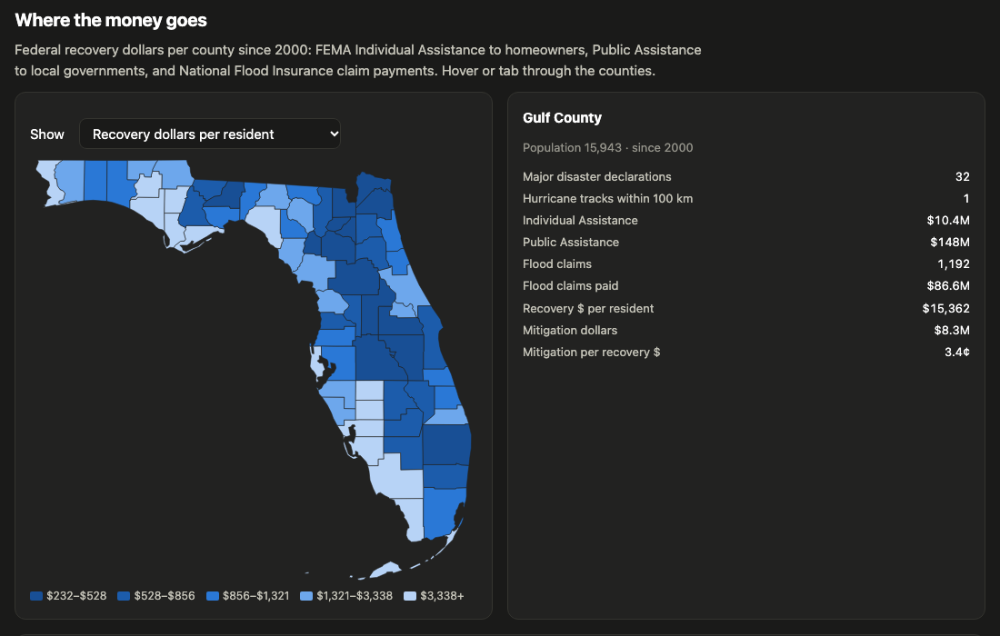

# Florida Disaster Warehouse

A tested, incrementally loaded data warehouse that joins 25 years of FEMA disaster spending,
NOAA hurricane tracks and Census data for Florida's 67 counties. It answers three questions:
where federal recovery money goes, how long it takes to arrive, and whether a hurricane's
track can predict which counties will get federal aid.

**Live dashboard:** https://gopivardhan1965.github.io/florida-disaster-warehouse/ ·
**dbt docs & lineage:** https://gopivardhan1965.github.io/florida-disaster-warehouse/dbt/



## Architecture

```
 OpenFEMA API ─┐  extract/openfema.py   incremental by lastRefresh watermark (3 datasets),
 NOAA HURDAT2 ─┼─► extract/reference.py full refresh for the rest
 Census       ─┘          │
                          ▼
            data/raw/**.parquet         append-only, every column VARCHAR
                          │
                          ▼  dbt + DuckDB  (warehouse/)
   staging (9)   typed · deduped to latest version per business key · county keys resolved
   intermediate  storms · counties · storm×county exposure (haversine) · FEMA disaster ↔ NOAA storm match
   marts (8)     dim_county · dim_disaster · fct_disaster_county · fct_pa_projects · fct_hma_projects
                 fct_nfip_claims_county_year · mart_county_summary · ml_storm_county_features
                          │
                          ├─► model/train.py      scikit-learn, writes predictions back to the warehouse
                          └─► export/site_data.py docs/data.json → static dashboard on GitHub Pages
```

**Orchestration:** `.github/workflows/pipeline.yml` runs every Monday. It restores the previous
raw snapshot from the `data-latest` GitHub Release, pulls only rows FEMA changed since the last
watermark, runs `dbt build` (models + 51 tests), retrains the model, republishes the snapshot
and deploys the site. In the first week of each month it does a full refresh, so rows deleted
upstream drop out. The build fails, and the site is left unchanged, if any test fails.

| Source | Rows (FL) | Load |
|---|---:|---|
| OpenFEMA Disaster Declarations Summaries v2 | 2,794 | incremental |
| OpenFEMA FEMA Web Disaster Summaries v1 | 4,046 (national) | incremental |
| OpenFEMA Public Assistance Funded Projects v2 | 74,625 | incremental |
| OpenFEMA Housing Assistance Owners v2 | 22,626 | full |
| OpenFEMA Hazard Mitigation Assistance Projects v4 | 5,947 | full |
| OpenFEMA NFIP Claims v3 | 448,618 | full |
| NOAA NHC HURDAT2 (Atlantic, 1851–2025) | 55,524 track points | full |
| Census population estimates + gazetteer | 67 counties | full |

## Data quality: what the tests caught

Each of these was a real failure during development, and each is now covered by a test:

- **Miami-Dade's old county code.** 323 mitigation projects use FIPS `12025`, Dade County's
  code before it was renamed Miami-Dade (`12086`) in 1997. A `relationships` test flagged them,
  and a shared `fl_county_fips` macro now maps the old code in every staging model.
- **Dropped dollars.** `assert_county_dollars_reconcile` checks that county-level Public
  Assistance adds up to FEMA's own per-disaster total (within 5%). It showed the fact table was
  losing money spent in counties without a county-level declaration row, so the grain became
  "every disaster × county seen in any source".
- **Totals without detail.** Fire-management grants appear in FEMA's disaster summaries but
  publish no project rows. They're explicitly excluded from reconciliation instead of
  silently mismatching.
- **Spelling drift.** County names arrive as `Miami-Dade (County)`, `DADE`, `St. Johns` and
  `De Soto`. A normalised `county_key` resolves them, and `assert_ihp_county_names_resolve`
  fails the build on any new unresolvable name. Tribal reservations are expected and excluded.
- **Storm linkage.** `assert_hurricane_disasters_linked_to_storms` requires every hurricane or
  tropical-storm major disaster since 2000 to be linked to a HURDAT2 track. Multi-storm titles
  like "Tropical Storm Bonnie and Hurricane Charley" are handled.

## The model: will this county get FEMA Individual Assistance?

Grain: storm × county, for every storm since 2000 that passed within 300 km of a county
(3,205 rows, 446 positives, 104 storms). The features are measured *near the county*: closest
distance, wind at closest approach, maximum wind within 100 and 200 km, hours within 200 km, a
landfall flag, log population and water share.

| | ROC AUC, CV split by storm | ROC AUC, train ≤2019 → test 2020+ | PR AUC, 2020+ |
|---|---:|---:|---:|
| Baseline rule: hurricane-force wind within 100 km | 0.674 | 0.725 | 0.483 |
| **Logistic regression** | **0.841** | **0.923** | 0.739 |
| Gradient boosting | 0.785 | 0.895 | **0.744** |

- On held-out 2024 Hurricane Milton, the model flagged 32 of the 34 counties that received
  Individual Assistance, with 1 false alarm.
- **Feature leakage, caught by the per-storm breakdown.** The first version used each storm's
  *lifetime* peak wind. It raised 56 false alarms for Tropical Storm Eta, which peaked as a
  Category 4 over Central America but was weak in Florida. Using wind near the county instead
  raised the 2020+ ROC AUC from 0.896 to 0.923.
- **Limits.** Most remaining false alarms are tropical storms that never got an Individual
  Assistance declaration at all (Alex, Elsa, Fred, Mindy). Declarations also depend on damage
  thresholds and state requests, which storm tracks can't see. Class weighting helps ranking
  but leaves the probabilities under-calibrated (Brier ≈ 0.16), so read them as a ranking, not
  as literal odds.

## Run it locally

Requires [uv](https://docs.astral.sh/uv/).

```bash
uv sync
make all        # extract → dbt build (models + tests) → model → export → dbt docs
python -m http.server -d docs   # http://localhost:8000
```

Individual steps: `make extract`, `make transform`, `make model`, `make export`, `make docs`.
The first extract takes about 10 minutes (NFIP claims dominate); later runs are incremental.

All data is public. Dollar figures are nominal (not adjusted for inflation).
